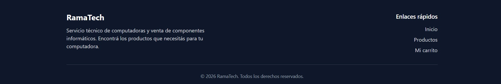
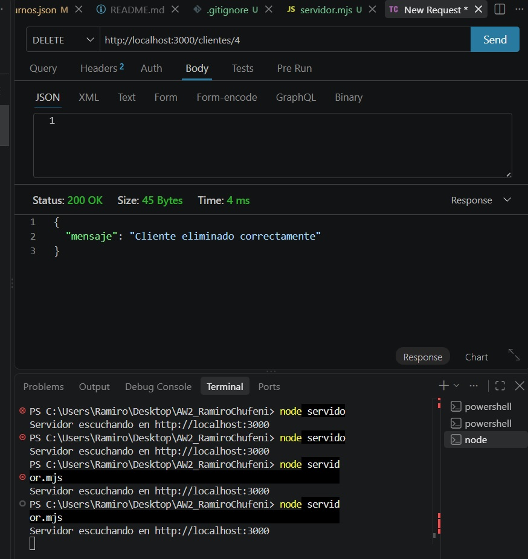

# Aplicaciones Web 2 - Tercera etapa del trabajo práctico

El proyecto representa un sistema de gestión para un servicio técnico de computación llamado RamaTech. La idea es organizar la información de los clientes, los servicios que ofrece el negocio, los turnos solicitados y también permitir la venta de productos y componentes de computación.

Para representar estos datos se utilizaron distintos archivos JSON relacionados entre sí:

- clientes.json: contiene la información de los clientes registrados.
- servicios.json: contiene los distintos servicios técnicos disponibles.
- turnos.json: contiene los turnos solicitados por los clientes.
- productos.json: contiene los productos disponibles para la venta, junto con su categoría, precio y stock.
- ordenes.json: contiene las órdenes de compra generadas desde el carrito.
- usuarios.json: contiene los usuarios registrados y sus contraseñas protegidas.

En esta tercera etapa se agregó una interfaz utilizando Astro y Tailwind CSS. El proyecto se organizó utilizando un modelo monorepo, separando el backend y el frontend dentro del mismo repositorio.

El backend continúa utilizando Express.js y se encarga de gestionar los datos almacenados en los archivos JSON. Además, se organizó siguiendo el modelo MVC, separando los modelos, controladores y rutas de cada módulo.

Las rutas utilizadas son:

- GET /clientes: obtiene todos los clientes registrados.
- GET /clientes/:id: obtiene un cliente específico mediante su ID.
- GET /servicios: obtiene todos los servicios disponibles.
- GET /turnos: obtiene todos los turnos registrados.
- GET /productos: obtiene todos los productos disponibles.
- GET /productos?categoria=: permite filtrar los productos según su categoría.
- POST /clientes: permite registrar un nuevo cliente.
- POST /turnos: permite registrar un nuevo turno, verificando que el cliente y los servicios existan.
- POST /ordenes: permite generar una orden de compra, comprobar el stock y actualizar las cantidades disponibles.
- PUT /clientes/:id: permite actualizar los datos de un cliente.
- DELETE /clientes/:id: permite eliminar un cliente siempre que no tenga turnos asociados.
- POST /usuarios/registro: permite registrar un nuevo usuario.
- POST /acceso/verificar: permite iniciar sesión.
- GET /acceso/sesion: permite comprobar si existe una sesión iniciada.
- POST /acceso/cerrar: permite cerrar sesión.

Para el registro y el inicio de sesión se utilizaron bcryptjs para proteger las contraseñas, JWT para manejar la autenticación y cookies para conservar la sesión del usuario.

En el frontend se desarrollaron las siguientes funcionalidades:

- Listado de todos los productos disponibles.
- Filtro de productos por categoría.
- Carrito de compras utilizando localStorage para conservar la información.
- Posibilidad de aumentar, disminuir o eliminar productos del carrito.
- Registro e inicio de sesión de usuarios.
- Generación de una orden de compra asociada al cliente que inició sesión.
- Actualización automática del stock al realizar una compra.
- Redirección al inicio de sesión cuando un usuario intenta comprar sin estar autenticado.
- Encabezado con información de la sesión y pie de página con enlaces de navegación.

La interfaz mantiene la idea original del proyecto como un servicio técnico de computación, mostrando los servicios disponibles y agregando una sección de venta de productos y componentes.

## Cómo ejecutar el proyecto

Para ejecutar el proyecto es necesario tener instalados Node.js, NPM y OpenSSH.

Desde la carpeta principal se instalan las dependencias con los siguientes comandos:

```powershell
npm install
npm install --prefix backend
npm install --prefix frontend
```

Como los usuarios y las claves de autenticación se guardan localmente, es necesario preparar esos archivos.

Primero se crea el archivo de usuarios a partir del ejemplo incluido:

```powershell
Copy-Item backend/api-crud/datos/usuarios.ejemplo.json backend/api-crud/datos/usuarios.json
```

Después se generan las claves RSA utilizadas para el inicio de sesión:

```powershell
New-Item -ItemType Directory -Force backend/api-crud/configuraciones/claves
Push-Location backend/api-crud/configuraciones/claves
ssh-keygen -t rsa -b 2048 -m PEM -f privada.key
ssh-keygen -e -m PEM -f privada.key.pub | Set-Content -Encoding ascii publica.key
Pop-Location
```

Al generar las claves se puede dejar la contraseña vacía, presionando Enter dos veces, para las pruebas locales.

Dentro de la carpeta `backend` se debe crear un archivo `.env` con estas variables:

```env
RSA_CLAVE_PRIVADA=api-crud/configuraciones/claves/privada.key
RSA_CLAVE_PUBLICA=api-crud/configuraciones/claves/publica.key
```

Finalmente, desde la carpeta principal se inicia el proyecto con:

```powershell
npm run dev
```

El backend funciona en `http://localhost:3000` y el frontend en `http://localhost:4321`.

Para probar una compra se debe ingresar al frontend, crear una cuenta desde el formulario de registro, iniciar sesión, agregar productos al carrito y finalizar la compra. La orden generada se guarda en `ordenes.json` y el stock se actualiza en `productos.json`.

## Capturas de prueba

Vista principal de RamaTech, donde se presenta el servicio técnico de computación:


Vista del pie de página agregado a la interfaz:



Vista de los servicios técnicos disponibles:


Vista del carrito de compras con los productos seleccionados:


Ejemplo de una orden generada desde el carrito y almacenada en ordenes.json:


Ejemplo de eliminación de un cliente mediante la ruta DELETE:



Las capturas muestran el funcionamiento de la interfaz, el carrito de compras, la comunicación con el backend y la generación de órdenes de compra.