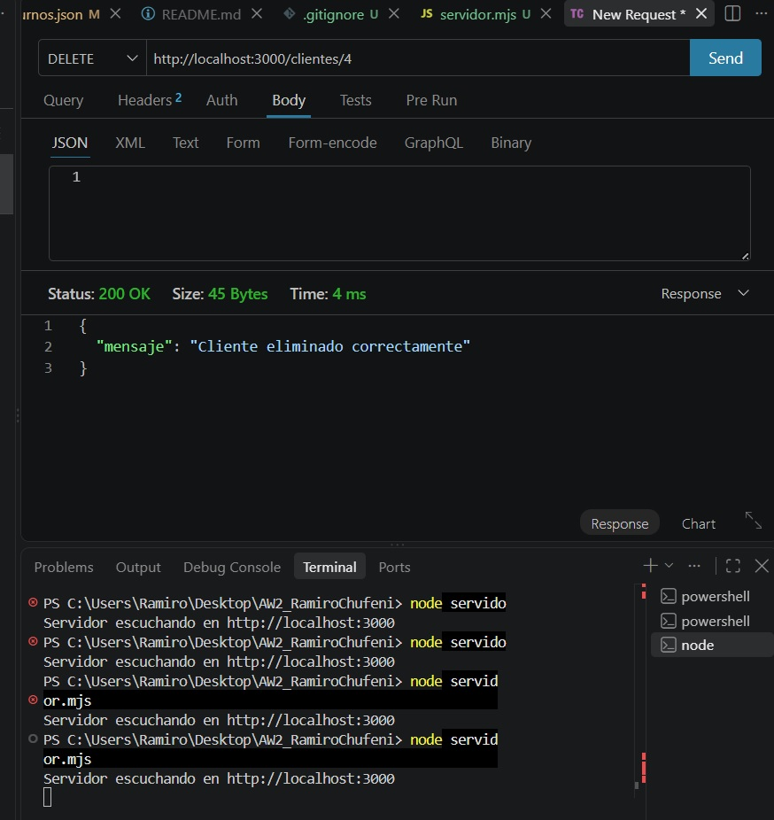

# Aplicaciones Web 2 - Tercera etapa de trabajo practico

El proyecto representa un sistema de gestión para un servicio técnico de computación. La idea es organizar la información de los clientes, los servicios que ofrece el negocio, los turnos solicitados y también permitir la venta de productos y componentes de computación.

Para representar estos datos se utilizaron distintos archivos JSON relacionados entre sí:

- clientes.json: contiene la información de los clientes registrados.

- servicios.json: contiene los distintos servicios técnicos disponibles.

- turnos.json: contiene los turnos solicitados por los clientes.

- productos.json: contiene los productos disponibles para la venta, junto con su categoría, precio y stock.

- ordenes.json: contiene las órdenes de compra generadas desde el carrito.

En esta tercera etapa se agregó una interfaz utilizando Astro y Tailwind CSS. El proyecto se organizó utilizando un modelo monorepo, separando el backend y el frontend dentro del mismo repositorio.

El backend continúa utilizando Express.js y se encarga de gestionar los datos almacenados en los archivos JSON.

Las rutas utilizadas son:

- GET /clientes: obtiene todos los clientes registrados.

- GET /clientes/:id: obtiene un cliente específico mediante su ID.

- GET /servicios: obtiene todos los servicios disponibles.

- GET /turnos: obtiene todos los turnos registrados.

- GET /productos: obtiene todos los productos disponibles.

- GET /productos?categoria=: permite filtrar los productos según su categoría.

- POST /clientes: permite registrar un nuevo cliente.

- POST /turnos: permite registrar un nuevo turno. Antes de crearlo se verifica que el cliente y los servicios indicados existan.

- POST /ordenes: permite generar una nueva orden de compra. Se verifica que el cliente y los productos existan, se controla el stock, se calcula el total y se actualiza la cantidad disponible de cada producto.

- PUT /clientes/:id: permite actualizar los datos de un cliente existente.

- DELETE /clientes/:id: permite eliminar un cliente siempre que no tenga turnos asociados.

Para mantener la integridad de los datos, al intentar eliminar un cliente se verifica primero si posee turnos relacionados. Si el cliente tiene turnos registrados, la eliminación no se realiza.

En el frontend se desarrollaron las siguientes funcionalidades:

- Listado de todos los productos disponibles.

- Filtro de productos por categoría.

- Carrito de compras utilizando localStorage para conservar la información.

- Posibilidad de aumentar, disminuir o eliminar productos del carrito.

- Selección del cliente que realiza la compra.

- Generación de una orden de compra mediante la comunicación entre el frontend y el backend.

- Actualización automática del stock al realizar una compra.

La interfaz mantiene la idea original del proyecto como un servicio técnico de computación, mostrando los servicios disponibles y agregando una sección de venta de productos y componentes.

También se agregó un archivo .gitignore para evitar la subida de las carpetas node_modules y del archivo package-lock.json al repositorio.

## Capturas de prueba

Vista principal de RamaTech, donde se presenta el servicio técnico de computación:

Vista de los servicios técnicos disponibles:

Vista del carrito de compras con los productos seleccionados:

Ejemplo de una orden generada desde el carrito y almacenada en ordenes.json:

Ejemplo de eliminación de un cliente mediante la ruta DELETE:

Las capturas muestran el funcionamiento de la interfaz, el carrito de compras, la comunicación con el backend y la generación de órdenes de compra.