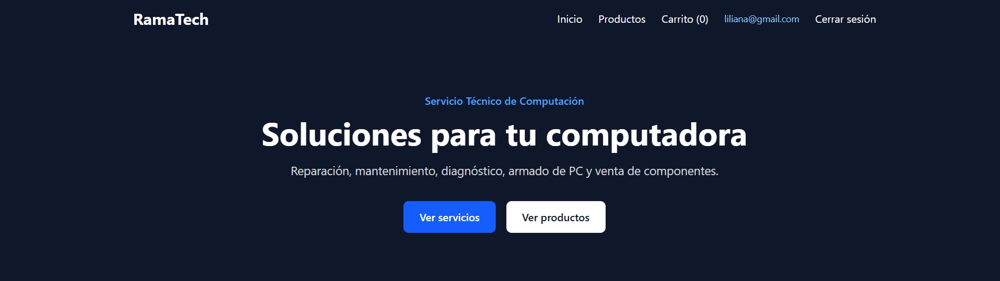
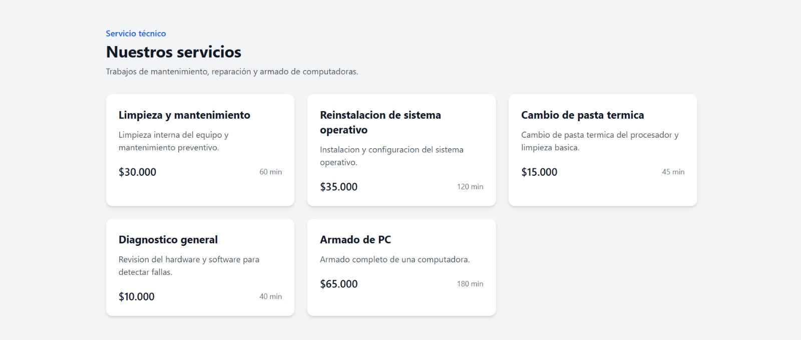
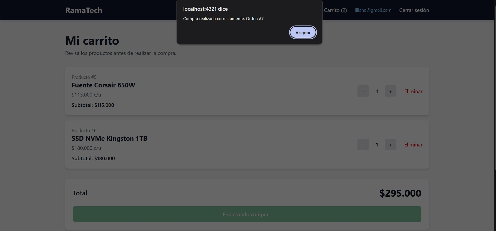
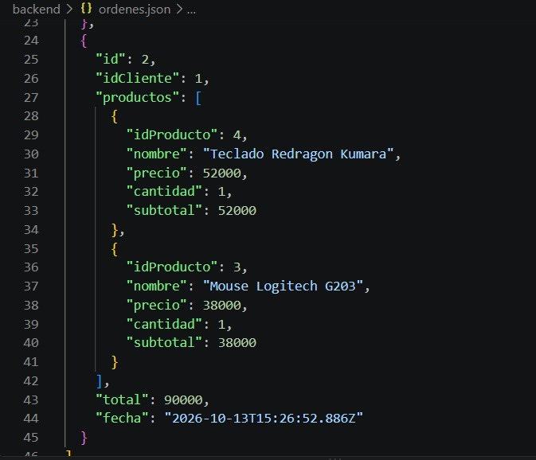

# Aplicaciones Web 2 - Cuarta etapa del trabajo práctico

El proyecto representa un sistema de gestión para un servicio técnico de computación llamado RamaTech. La idea es organizar la información de los clientes, los servicios que ofrece el negocio, los turnos solicitados y también permitir la venta de productos y componentes de computación.

**Repositorio de GitHub:** https://github.com/ramirochufeni/AplicacionesWeb2_RamiroLautaroChufeni

En las primeras etapas, para representar estos datos se utilizaron distintos archivos JSON relacionados entre sí:

- clientes.json: contiene la información de los clientes registrados.

- servicios.json: contiene los distintos servicios técnicos disponibles.

- turnos.json: contiene los turnos solicitados por los clientes.

- productos.json: contiene los productos disponibles para la venta, junto con su categoría, precio y stock.

- ordenes.json: contiene las órdenes de compra generadas desde el carrito.

- usuarios.json: contiene los usuarios registrados y sus contraseñas protegidas.

En la tercera etapa se agregó una interfaz utilizando Astro y Tailwind CSS. El proyecto se organizó utilizando un modelo monorepo, separando el backend y el frontend dentro del mismo repositorio.

El backend continúa utilizando Express.js y está organizado siguiendo el modelo MVC, separando los modelos, controladores y rutas de cada módulo. En la cuarta etapa se reemplazó el almacenamiento en archivos JSON por una base de datos MongoDB, manteniendo la misma organización y las funcionalidades de la aplicación.

El frontend muestra las páginas de RamaTech y envía solicitudes al backend. El backend procesa esas solicitudes y consulta o modifica la información en MongoDB.

Las rutas utilizadas son:

- GET /clientes: obtiene todos los clientes registrados.

- GET /clientes/:id: obtiene un cliente específico mediante su ID.

- GET /servicios: obtiene todos los servicios disponibles.

- GET /turnos: obtiene los turnos del cliente que inició sesión.

- GET /productos: obtiene todos los productos disponibles.

- GET /productos?categoria=: permite filtrar los productos según su categoría.

- POST /clientes: permite registrar un nuevo cliente.

- POST /turnos: permite registrar un nuevo turno, verificando que el cliente y los servicios existan.

- POST /ordenes: permite generar una orden de compra, comprobar el stock y actualizar las cantidades disponibles. Esta ruta requiere iniciar sesión.

- PUT /clientes/:id: permite actualizar los datos de un cliente.

- DELETE /clientes/:id: permite eliminar un cliente siempre que no tenga turnos, órdenes o una cuenta de usuario asociada.

- POST /usuarios/registro: permite registrar un nuevo usuario.

- POST /acceso/verificar: permite iniciar sesión.

- GET /acceso/sesion: permite comprobar si existe una sesión iniciada.

- POST /acceso/cerrar: permite cerrar sesión.

Para el registro y el inicio de sesión se utilizaron bcryptjs para proteger las contraseñas, JWT para manejar la autenticación y cookies para conservar la sesión del usuario. En esta cuarta etapa se adaptó esa lógica para que los usuarios se consulten directamente en MongoDB.

En el frontend se desarrollaron las siguientes funcionalidades:

- Listado de todos los productos disponibles.

- Filtro de productos por categoría.

- Carrito de compras utilizando localStorage para conservar la información.

- Posibilidad de aumentar, disminuir o eliminar productos del carrito.

- Registro e inicio de sesión de usuarios.

- Generación de una orden de compra asociada al cliente que inició sesión.

- Actualización automática del stock al realizar una compra.

- Redirección al inicio de sesión cuando un usuario intenta comprar sin estar autenticado.

- Encabezado con información de la sesión y pie de página con enlaces de navegación.

- Solicitud de turnos para servicios técnicos desde la página web.

La interfaz mantiene la idea original del proyecto como un servicio técnico de computación, mostrando los servicios disponibles y agregando una sección de venta de productos y componentes.

## Cuarta etapa del trabajo práctico

En esta etapa se cambió el almacenamiento de los datos a MongoDB. Se instalaron MongoDB Community Server y MongoDB Compass para trabajar con una base de datos local llamada `ramatech`.

Se crearon seis colecciones: `clientes`, `servicios`, `turnos`, `productos`, `ordenes` y `usuarios`. Los datos que antes estaban en los archivos JSON se migraron a estas colecciones, conservando los identificadores y las relaciones entre clientes, turnos, usuarios y órdenes.

Para conectar el backend con MongoDB se utilizó el paquete `mongodb` de Node.js. Los modelos ahora realizan consultas y operaciones sobre la base de datos utilizando `async` y `await`. Los controladores también se adaptaron para trabajar con estas operaciones asíncronas.

Se mantuvo la estructura MVC y se utilizaron módulos de JavaScript con `import` y `export`. El frontend desarrollado con Astro no necesitó cambios para realizar la migración.

También se realizaron las siguientes mejoras:

- El registro de usuarios guarda los datos del cliente y la cuenta en MongoDB, con la contraseña protegida mediante bcryptjs.

- El inicio de sesión verifica las credenciales y genera un token JWT firmado con claves RSA.

- El token se conserva en una cookie `HttpOnly` y se comprueba antes de permitir una compra.

- La consulta de sesión devuelve el estado de autenticación y evita almacenar esa respuesta en caché.

- Las compras generan órdenes en MongoDB y actualizan el stock de los productos.

- El descuento de stock comprueba que haya unidades suficientes antes de realizar la modificación.

- Si no hay stock suficiente, el backend rechaza la compra sin generar una orden nueva.

- Se actualizaron las dependencias del backend y la auditoría de npm terminó sin vulnerabilidades conocidas en las dependencias de producción.

Se probaron las cuatro operaciones CRUD de clientes: crear un cliente, consultarlo, modificar sus datos y eliminarlo. Después de eliminar el cliente de prueba, una nueva consulta devolvió el código HTTP 404, confirmando que ya no existía.

También se probó la creación de un turno y la compra de un producto. En la compra de prueba se generó una nueva orden y el stock pasó de 3 a 2 unidades. Luego se intentó comprar 3 unidades cuando solamente quedaban 2, y el sistema rechazó correctamente la operación sin modificar las órdenes ni el stock.

Para el control de stock se utilizan actualizaciones condicionales de MongoDB. Si ocurre un error durante una compra, el backend intenta recuperar las unidades descontadas. Como la base local está configurada sin transacciones multidocumento, esta recuperación no reemplaza una transacción completa ante fallos inesperados del servidor.

Uno de los principales desafíos de esta etapa fue pasar de archivos JSON a MongoDB sin perder las funcionalidades anteriores. Para lograrlo se fueron adaptando los modelos y controladores, revisando errores y probando cada parte del sistema.

## Tecnologías y dependencias

Las tecnologías y dependencias principales del proyecto son:

- HTML, CSS, JavaScript, Astro y Tailwind CSS para el frontend.
- Node.js y Express.js para el backend y las rutas de la API.

- MongoDB y el controlador oficial `mongodb` para almacenar y consultar los datos.

- bcryptjs para proteger las contraseñas de los usuarios.

- jsonwebtoken para la autenticación mediante JWT.

- cookie-parser, cors y dotenv para el manejo de cookies, las peticiones entre el frontend y el backend y las variables de entorno.


- localStorage para conservar los productos del carrito en el navegador.
- concurrently para iniciar el frontend y el backend con un solo comando.

## Cómo ejecutar el proyecto

Para ejecutar el proyecto es necesario tener instalados Node.js, NPM, OpenSSH y MongoDB Community Server. MongoDB Compass es opcional, pero sirve para consultar las colecciones y comprobar los datos guardados.

Desde la carpeta principal se instalan las dependencias con los siguientes comandos:
```powershell
npm install
npm install --prefix backend
npm install --prefix frontend
```

Antes de iniciar la aplicación, MongoDB debe estar funcionando y disponible en `mongodb://127.0.0.1:27017`. La aplicación utiliza por defecto una base de datos llamada `ramatech`.

Después se generan las claves RSA utilizadas para la autenticación de usuarios:
```powershell
New-Item -ItemType Directory -Force backend/api-crud/configuraciones/claves
Push-Location backend/api-crud/configuraciones/claves
ssh-keygen -t rsa -b 2048 -m PEM -f privada.key
ssh-keygen -e -m PEM -f privada.key.pub | Set-Content -Encoding ascii publica.key
Pop-Location
```

Al generar las claves se puede dejar la contraseña vacía, presionando Enter dos veces, para las pruebas locales.

Dentro de la carpeta `backend` se debe crear un archivo `.env` con estas variables:
```env
RSA_CLAVE_PRIVADA=api-crud/configuraciones/claves/privada.key
RSA_CLAVE_PUBLICA=api-crud/configuraciones/claves/publica.key
MONGODB_URI=mongodb://127.0.0.1:27017
MONGODB_DB=ramatech
```

En una instalación nueva, si se cuenta con los archivos JSON originales, se pueden migrar sus datos a MongoDB utilizando el script preparado para esta etapa:
```powershell
cd backend
node scripts/migrar-json-mongodb.mjs --importar
cd ..
```

Esta migración se realiza solamente para cargar los datos iniciales. No debe repetirse sobre una base de datos que ya contiene información, porque podría reemplazar los datos existentes.

Las cuentas nuevas se crean directamente desde el formulario de registro y se guardan en MongoDB.

Finalmente, para iniciar RamaTech, desde la carpeta principal del proyecto se ejecuta:
```powershell
npm run dev
```

Este comando inicia automáticamente los dos servidores utilizando `concurrently`, por lo que no es necesario abrirlos por separado.

El frontend desarrollado con Astro se puede utilizar desde:

- `http://localhost:4321` — aplicación web de RamaTech.

El backend desarrollado con Express funciona en:

- `http://localhost:3000` — API encargada de gestionar los datos, la autenticación y las operaciones del sistema.

Por ejemplo, se pueden consultar los productos directamente desde `http://localhost:3000/productos`.

Para probar una compra se debe ingresar al frontend, crear una cuenta desde el formulario de registro, iniciar sesión, agregar productos al carrito y finalizar la compra.

La orden generada se guarda en la colección `ordenes` de MongoDB y el stock se actualiza en la colección `productos`.

## Capturas de prueba

Vista principal de RamaTech, donde se presenta el servicio técnico de computación:



Vista del pie de página agregado a la interfaz:


Vista de los servicios técnicos disponibles:



Vista del carrito de compras con los productos seleccionados:



Ejemplo de una orden generada desde el carrito en la tercera etapa, cuando se almacenaba en `ordenes.json`:



Ejemplo de eliminación de un cliente mediante la ruta DELETE:


Las capturas muestran el funcionamiento de la interfaz, el carrito de compras, la comunicación con el backend y la generación de órdenes de compra. En la cuarta etapa, esas órdenes se almacenan en MongoDB en lugar de archivos JSON.

## Mejoras

Después de finalizar la cuarta etapa, se agregó una nueva funcionalidad para que los usuarios puedan solicitar turnos directamente desde la página de RamaTech.

Antes, los servicios técnicos solamente se mostraban de manera informativa. Ahora, cada servicio tiene un botón Solicitar turno, que permite elegir una fecha, una hora y describir el problema o que necesita el equipo.

Para implementar esta mejora se aprovechó el módulo de turnos que ya existía en el backend y se realizaron los siguientes cambios:

- Se creó un formulario para solicitar turnos.

- Los turnos se guardan en MongoDB y quedan asociados al cliente que inició sesión.

- Si el usuario no inició sesión, se lo dirige al login para que pueda ingresar y volver al formulario.

- Se agregaron validaciones para evitar fechas pasadas y servicios inexistentes.

- Se protegieron las rutas de turnos mediante JWT, para que cada usuario pueda consultar solamente sus propios turnos.

## Video demostrativo del TP4

En el video se muestra el funcionamiento de RamaTech, el inicio de sesión, las operaciones CRUD de clientes, la base de datos MongoDB y la generación de órdenes con control de stock. También se presenta la estructura del proyecto y las tecnologías utilizadas.

**Enlace al video:** https://drive.google.com/file/d/1FQr-o8JaZsasfuvEz_uS6wzLTHrgyUx0/view?usp=sharing